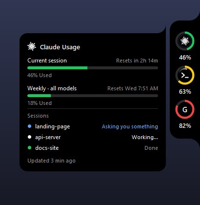
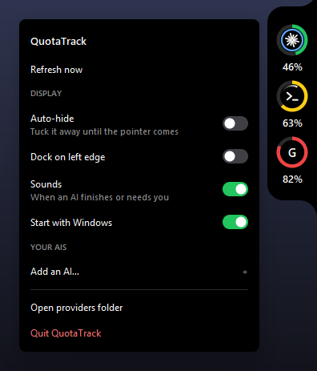

<div align="center">

# QuotaTrack

**See how much of your AI usage limits you've used, and whether each AI is working or waiting on you, from
a slim rail on the edge of your screen.**

[](#install)
[](#install)
[](#install)
[](https://www.python.org/downloads/)
[](#how-it-works)
[](LICENSE)



</div>

---

Claude, Codex, Copilot, Cursor and the rest each hide their limits in a different menu. QuotaTrack puts them
all in one place, always on screen:

- 🟢 **One ring per AI**: green below 50%, yellow from 50%, red from 70%.
- 🔍 **Hover a ring** to see each limit, how much of it is used, and when it resets.
- ⏳ **Working:** a white arc spins inside the ring while an AI is busy.
- 🔵 **Waiting for your reply:** a blue ring blinks when an AI has asked you something or needs your approval.
- 🖱️ **Click it** to jump straight to that chat in the Claude or Codex app, or to the terminal it runs in.
- ✅ **Done:** finished chats show "Done" for 5 minutes, then drop off the list.
- 🔔 **Alerts:** the card pops out, with an optional sound, when an AI finishes or needs you, and when a limit
  passes 80% or 100%.
- 🧩 **Add any AI** from the menu, without writing code.

It only shows the AIs you actually have installed, so it works out of the box on anyone's PC.

## Supported AIs

| AI | Usage limits | Working / waiting | Needs a switch? |
| --- | :---: | :---: | :---: |
| **Claude** (desktop app and Claude Code) | ✅ | ✅ | No; optional live mode |
| **Codex** (ChatGPT plan) | ✅ | ✅ | No; optional live mode |
| **Antigravity** | ✅ | — | No |
| **GitHub Copilot** | ✅ | — | Yes |
| **Cursor** | ✅ | — | Yes |
| **Kimi Code** | ✅ | — | Yes |
| **Grok CLI** *(untested)* | ✅ | — | Yes |
| **Anything else** | ✅ via [Add an AI](#add-your-own-ai) | — | — |

AIs that need a switch keep no usage figures on your PC, so QuotaTrack has to ask the service for them. It
only does that once you turn that AI's **Live usage** switch on in the right-click menu (see
[Privacy](#privacy-and-safety)).

## Install

### Download the app (easiest)

Grab the latest build from [**Releases**](https://github.com/Donelongo/QuotaTrack/releases/latest). There's
nothing else to install, not even Python.

- **Windows:** download `QuotaTrack-Windows.exe` and double-click it. Windows may say it "protected your PC"
  because the app isn't signed: click **More info → Run anyway**.
- **macOS** *(Apple silicon)*: download `QuotaTrack-macOS.zip`, unzip it and drag **QuotaTrack** into
  **Applications**. The app isn't signed, so the first time, right-click it and choose **Open** (or allow it under
  **System Settings → Privacy & Security**).
- **Linux** *(x86-64, beta)*: download `QuotaTrack-Linux.tar.gz`, unpack it (`tar -xzf QuotaTrack-Linux.tar.gz`)
  and run `./QuotaTrack`. It needs an X11 desktop, or a Wayland one with XWayland (GNOME, KDE and most others
  have it).

The app runs in the background: no window in the taskbar, no Dock icon, just the rail. The first time it runs it
sets itself to **start when you sign in** (and restarts itself if it ever crashes on macOS), so it's always
there. Turn that off in the right-click menu if you'd rather not, and choose **Quit QuotaTrack** there to close
it. Its settings are kept in `%APPDATA%\QuotaTrack` on Windows, `~/Library/Application Support/QuotaTrack`
on macOS and `~/.config/QuotaTrack` on Linux.

### Run from source

QuotaTrack is plain Python with no packages to install.

**Windows**

1. Install [Python 3](https://www.python.org/downloads/) (3.9 or newer; tested on 3.14).
2. Download this repo (**Code → Download ZIP**, or clone it):
   ```bash
   git clone https://github.com/Donelongo/QuotaTrack.git
   ```
3. Double-click **`quotatrack.pyw`**.

**macOS**

```bash
git clone https://github.com/Donelongo/QuotaTrack.git
cd QuotaTrack
python3 quotatrack.pyw
```

Use Python from [python.org](https://www.python.org/downloads/), or Homebrew's Python with
`brew install python-tk`.

**Linux** *(beta)*

```bash
git clone https://github.com/Donelongo/QuotaTrack.git
cd QuotaTrack
python3 quotatrack.pyw
```

If Python says there's no `tkinter`, install it: `sudo apt install python3-tk` (Debian, Ubuntu), `sudo dnf
install python3-tkinter` (Fedora) or `sudo pacman -S tk` (Arch). It needs an X11 desktop, or Wayland with
XWayland. The rail's curved ends have crisp rather than smooth edges on Linux. Sounds use `canberra-gtk-play` or
`paplay` when installed, and clicking a waiting session brings its window forward only if `wmctrl` is installed.

**Start it automatically:** right-click the rail and turn on **Start with Windows** (**Start at login** on
macOS and Linux, which adds `~/.config/autostart/quotatrack.desktop`).

Want to look around first? Run `python quotatrack.pyw --demo` to see it with sample figures.

**Build the app yourself:** `pip install pyinstaller`, then `pyinstaller packaging/QuotaTrack.spec`; it lands in
`dist/`. Pushing a `v*` tag builds the Windows, macOS and Linux apps on GitHub and attaches them to a release.

## Using it

| Do this | To |
| --- | --- |
| **Hover** a ring | See its limits, reset times and live sessions |
| **Click** a blinking ring | Jump to the chat that's waiting for you |
| **Click** a session in the card | Open that chat |
| **Drag** the rail | Move it up or down the edge (the position is remembered) |
| **Right-click** | Open the menu |



The menu has switches for **Auto-hide**, **Dock on left edge**, **Sounds** and **Start with Windows**; a
**Live usage** switch for each AI that needs one; and your own AIs. It closes when your pointer leaves it.
Settings are saved in `config.json` next to `quotatrack.pyw` (or in the folder above, for the downloaded app).

## Privacy and safety

QuotaTrack is built to be safe to run:

- **Local by default.** Out of the box it only reads files your AI apps already keep on your computer. It
  makes no network requests, and it never changes another app's settings or files.
- **Live modes are opt-in, one AI at a time.** When you turn one on, QuotaTrack reads the sign-in that AI's own
  app saved, without refreshing or rewriting it. It sends that sign-in only to the service's own address, and
  refuses redirects so it can't be forwarded anywhere else. It asks at most every 5 minutes (Claude: every minute;
  its usage lookup isn't a message, so it costs none of your quota). If Claude Code's sign-in has expired,
  QuotaTrack runs `claude auth status` so Claude Code renews it itself.
- **No tokens in the repo.** `config.json` and `custom_ais.json`, which can hold API keys, are git-ignored.
- **Small and readable.** No third-party packages. Each AI is one short file in [`providers/`](providers), so
  you can check exactly what it reads.

<details>
<summary><b>Exactly what each AI reads</b></summary>

| AI | Usage from | Working / waiting from |
| --- | --- | --- |
| Claude | The Claude desktop app's `plan-usage-history.json` | Claude Code's `~/.claude/sessions/*.json` (the `.key` files beside them are never opened) |
| Codex | The rate limits Codex logs in `~/.codex/sessions` after each message | `task_started` / `task_complete` events in the same logs |
| Claude, live mode | `api.anthropic.com/api/oauth/usage` (what Claude Code's `/usage` shows), with `accessToken` from `~/.claude/.credentials.json` | — |
| Codex, live mode | `chatgpt.com/backend-api/wham/usage`, with `access_token` and `account_id` from `~/.codex/auth.json` | — |
| Antigravity | Antigravity's own local server on `127.0.0.1`, while Antigravity is open (nothing leaves your PC) | — |
| Copilot | `api.github.com/copilot_internal/user`, with the GitHub CLI's sign-in | — |
| Cursor | `cursor.com/api/usage-summary`, with the editor's own sign-in | — |
| Kimi Code | `api.kimi.com/coding/v1/usages`, with the Kimi Code CLI's sign-in | — |
| Grok CLI | `cli-chat-proxy.grok.com/v1/billing`, with Grok CLI's sign-in | — |

</details>

## How accurate is it?

- **Codex, Copilot, Cursor, Kimi and Antigravity** show the service's own figures. In Codex's default mode they're
  as of your last Codex message. Turn on live mode for the same numbers as the Codex app's **Usage remaining** menu.
- **Claude** in its default mode reads the usage the Claude desktop app saves to disk. The app saves a reading
  about every 15 minutes, but only while it's open and checking, so it can fall hours behind. Reset times are worked
  out from the saved readings, so they're marked with `~`. Turn on live mode for the same exact numbers and reset
  times as Claude Code's `/usage`, refreshed every minute.

## Add your own AI

**Without code:** right-click the rail and choose **Add an AI…**. Its numbers can come from:

- **You:** type how much you've used and when it resets (`3h`, `2d 4h`, `18:30` or `2026-10-22 14:00`). Click
  its ring to update them.
- **A web address that returns JSON:** for services with a usage API. Add a header if it needs a key, then name
  the fields that hold the numbers (`data.usage.percent`, `limits[0].used`). Press **Test** to check it.
- **A JSON file on this PC** that another tool keeps up to date.

<details>
<summary><b>With code</b></summary>

Each built-in AI is one file in [`providers/`](providers):

1. Copy `providers/_template.py` to `providers/<name>.py`.
2. Fill in `read()` to return the limit percentages. Optionally add `activity()` for working/waiting,
   `open_app()` for click-to-open, `SETTINGS` for switches in the menu, and `available()` to hide the ring
   until the AI is installed.
3. Restart QuotaTrack.

It gets its own ring automatically, with the first letter of its name or a PNG icon (`ICON = "file.png"`). A
provider is ordinary Python running on your computer, so only add ones you wrote or have read.

</details>

## How it works

- `quotatrack.pyw` is the app: the rail, rings, cards, animations and alerts, drawn with Tkinter.
- `providers/` has one file per AI, plus shared helpers for live requests (`_live.py`) and bringing a chat's
  window forward (`_focus.py`).
- `custom_ais.py` is the **Add an AI…** form.
- The curved ends of the rail and cards are separate windows with per-pixel transparency
  (`UpdateLayeredWindow` on Windows, a transparent Tk window on macOS), so they blend into whatever is behind
  them. On Linux they're black windows cut to shape with X's shape extension.
- Usage is read every 30 seconds and activity every 2 seconds, on background threads.

## Contributing

Bug reports, Mac test results and new providers are welcome. See [CONTRIBUTING.md](CONTRIBUTING.md).

## License

[MIT](LICENSE). QuotaTrack is an independent project, not affiliated with or endorsed by Anthropic, OpenAI,
Google, GitHub, Anysphere, Moonshot AI or xAI. Product names belong to their owners. Logos are read from each
app's installed files on your PC and aren't included in this repo.
