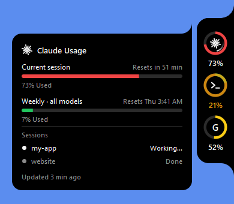

# AI Usage Notch

A small black notch pinned to the edge of your screen that shows how much of each AI's usage limit you've
used, and whether it's working, done, or waiting on you.



- **One ring per AI.** Green below 50%, yellow from 50%, red from 70%.
- **Hover a ring** for each limit window, how much is used, and when it resets.
- **Working:** a white arc spins just inside the usage ring while a session is busy.
- **Needs you:** a thin amber ring pulses inside it when a session needs your approval or input.
- **Waiting for your reply:** a thin blue ring shows when a session has finished its turn.
- The usage ring itself always keeps its own colour, so a state never changes what the percentage looks like.
- **Alerts:** the card pops open (with a sound you can turn off) when a session finishes or stops to ask you
  something, and when a limit crosses 80% or 100%.

## Safe by design

By default the built-in providers only **read files the AI apps already write on your computer**: no
network, no login tokens, and no changes to another app's settings.

| AI | Usage from | Working / waiting from |
| --- | --- | --- |
| Claude | Claude desktop's `plan-usage-history.json` (reset times are estimated, shown with `~`) | Claude Code's session files in `~/.claude/sessions/*.json` |
| Codex (ChatGPT plan) | The rate limits Codex logs in `~/.codex/sessions`, as of your last Codex message. Optional live mode, below | `task_started` / `task_complete` events in the same logs |
| Antigravity | Antigravity's own language server on `127.0.0.1`, while Antigravity is open (nothing leaves your PC; the last reading is kept while it's closed) | — |
| Kimi Code | Live only (Kimi keeps no usage locally): opt-in, below | — |

A ring only appears once its AI is set up on your PC, so Kimi shows up once you've signed in to Kimi Code, and
Antigravity once you've used it.

No third-party packages: it's plain Python and Tkinter.

### Codex live mode (opt-in)

Codex's logs only update when you send Codex a message, so usage from elsewhere (ChatGPT, cloud tasks) shows up
late. For the exact figures the Codex app's **Usage remaining** menu shows, right-click Notch and turn on
**Codex: Live usage from chatgpt.com**. Then Notch:

- reads `access_token` and `account_id` from `~/.codex/auth.json`, and never refreshes or writes that file
- sends them only to `https://chatgpt.com/backend-api/wham/usage`, refusing redirects so the token can't be
  forwarded anywhere else
- asks at most every 5 minutes, backs off if rate-limited, and falls back to the logs if a request fails

### Kimi live mode (opt-in)

Turn on **Kimi: Live usage from api.kimi.com**. Notch reads `access_token` from the Kimi Code CLI's
`~/.kimi-code/credentials/kimi-code.json` (never refreshing or writing it) and sends it only to
`https://api.kimi.com/coding/v1/usages`, with redirects refused, at most every 5 minutes. Kimi's tokens last
15 minutes and the CLI renews them, so if Kimi Code hasn't run lately the card asks you to run `kimi` once.

## Run it

**Windows:** install [Python 3](https://www.python.org/downloads/), then double-click `notch.pyw`, or run:

```bash
pythonw notch.pyw
```

**macOS** (untested so far): use Python from python.org, or Homebrew's Python plus `brew install python-tk`:

```bash
python3 notch.pyw
```

Add `--demo` to see it with sample figures. Only one copy runs at a time.

## Using it

- **Click a ring** to refresh it now. For an AI whose numbers you type in, clicking opens them to update.
- **Drag** the column up or down the edge. Its position is remembered.
- **Right-click** for: Refresh now, Auto-hide, Dock on left edge, sounds on/off, provider switches such as
  Codex live mode, Open providers folder, Quit.

Settings are saved in `config.json` next to `notch.pyw`.

## Adding another AI

### Without code

Right-click Notch and choose **Add an AI…**. Give it a name and pick where its numbers come from:

- **I'll type them in myself:** enter how much you've used and when it resets (like `3h`, `2d 4h`, `18:30`
  or `2026-10-22 14:00`). Click its ring whenever you want to update them.
- **A web address that returns JSON:** for services with a usage API. Add a header if it needs a key
  (`Authorization: Bearer YOUR-KEY`), then name the fields holding the numbers as paths into the JSON, such as
  `data.usage.percent` or `limits[0].used`, optionally with the field it's "out of" and its reset time.
  Notch fetches it every 5 minutes and never follows redirects, so your key stays with that address.
- **A JSON file on this PC:** the same field paths, for a file another tool keeps up to date.

Press **Test** to check before saving. Change or remove an AI later from **Edit an AI** in the same menu. These
are saved in `custom_ais.json` next to `notch.pyw`, which is kept out of git because it can hold an API key.

### With code

Each built-in AI is one file in [`providers/`](providers). To write one:

1. Copy `providers/_template.py` to `providers/<name>.py`.
2. Fill in `read()` to return the limit percentages. Optionally add `activity()` for working/waiting,
   `SETTINGS` for on/off switches in the right-click menu, and `available()` to hide the ring until the AI is
   set up.
3. Restart Notch.

It gets its own ring automatically, showing the first letter of its name, or a PNG icon you put in
`providers/`. A provider is ordinary Python running on your computer, so only add ones you wrote or have read.

## How it works

- `notch.pyw` is the app: the column, rings, hover cards, animations and alerts.
- `custom_ais.py` is the **Add an AI…** form and the provider that runs the AIs it saves.
- The straight middle of the column and of the card are ordinary windows. The curved ends are separate
  windows with per-pixel transparency (`UpdateLayeredWindow` on Windows, a transparent Tk window on macOS),
  so the curves blend smoothly into whatever is behind them.
- Usage is read every 30 seconds and activity every 2 seconds, on a background thread.
